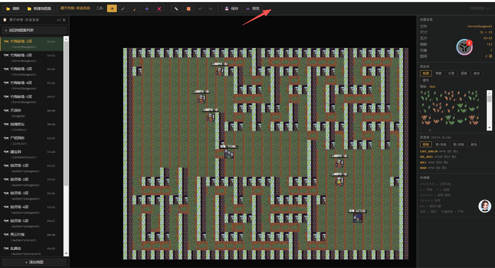

图1添加 贴图替换按钮，点击后选择某个素材进行替换（暂时只有compiled_tileset_32x32 ），然后就加载当前地图集的compiled_tileset_32x32.png 和 compiled_tileset_32x32.json(数据和格式根据这个功能的需求可以进行变动)，然后加载到工作区。点击某个格就是可以进行风格变化（参考图1就是选择的格），在右边的控制区输入 提示词和上传其他参参考图 就可以替换这一格的精灵贴图(注意要扣掉背景为透明背景)。
贴图替换按钮 按钮右边增加 “设置”按钮 复刻 D:\Users\viaco\tools\Toonflow-game\toonflow-game-app 
的文本大模型和生图模型的 配置方案和接口对接方案。