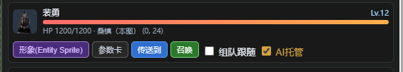

# AI托管V2

[]ai托管后面，增加按钮：行为链
点击后进入 行为链面板
默认显示已经做了的5件事和计划做的5件事。可以往前翻看。
因此ai托管后将会生成行为计划不少于5件事。然后角色会判断当前按计划走还是做临时行为改变计划。

计划行为的右边可以点击删除和改变和插入。

点击改变,进入行为编辑界面改变角色的行为计划。
插入，进入行为创建界面，保存后插入档选择的行为的后面。

# 设计
AI 托管 V2 —— 行为链
Context
现有 AI 托管是「LLM 每 5~20s 决策一个动作」（aiState.currentAction，完成即忘），用户看不到 AI 在想什么、也无法干预。ai/types.ts 里 AIState.actionQueue 字段已定义但从未使用。本次按 md/curr_design/.../ai托管V2.md 实现：

托管后 AI 生成 ≥5 步行为计划，顺序执行；紧急/临时行为只插队，不销毁计划
「AI托管」勾选旁新增行为链按钮 → 面板显示已完成 5 件 + 计划 5 件，历史可往前翻
计划行右侧可删除 / 改变 / 插入；改变→编辑界面，插入→创建界面（保存后插到所选行为之后）
架构定调：计划/历史为前端权威（LLM 决策系统全在前端 ai/ 目录，一次 LLM 调用产出整份计划，反而摊薄调度器单槽位成本）；每步执行仍翻译成现有 ai_command 通道（entry 的 _ai* 标志模式），entry.ts 零改动。计划+历史落库 t_plugin_session_data（key: ai_behavior_chains，会话级），刷新可恢复。

数据结构（vue/src/ai/types.ts 扩展）

ts
// 新增
interface PlanStep { id: string; note: string; action: AIAction; status: "pending"|"active"|"done"|"skipped"; createdAt: number }
interface HistoryEntry { id: string; note: string; type: string; finishedAt: number; result: "done"|"interrupted"|"failed" }
// AIState 增加（L74-107 附近）
plan: PlanStep[]; history: HistoryEntry[]; planSource: "ai"|"user"; awaitingPlan?: boolean;
实施步骤
① ai/plan.ts（新文件，纯逻辑、可 node 测）
常量 PLAN_MIN=5 / PLAN_MAX=8 / HISTORY_MAX=50
buildPlanSystemPrompt / buildPlanUserPrompt(entity, aiState, perception)：复用 brain.ts 的感知数据，输出契约 = { "plan": [ {"type","note","target"...} × 5~8 ] }，note 为一句中文描述（面板显示用）
parsePlanResponse(raw)：剥 ```json 围栏 → 白名单校验 type（move/attack/gather/interact/useSkill/useItem/flee/wait/follow）→ 裁剪字段 → PlanStep[]；非法步丢弃，<5 步时程序化补齐
buildFallbackPlan(perception)：LLM 失败/超时兜底，按感知程序化生成 5 步（采集最近资源→移动→攻击→跟随→等待）
状态机纯函数：takeNextPlanStep(aiState)（pending→active，设 currentAction）、finishPlanStep(aiState, result)（active→done 写历史 unshift、超 HISTORY_MAX 截断）、markPlanSkipped(aiState)
② ai/brain.ts 扩展
callBrainDetailed opts 加 planMode?: boolean：planMode 时用 plan prompt + parsePlanResponse，返回 { plan?: PlanStep[] }；原单步 prompt/parse 保持不动（#ai 聊天指令、短信回复继续走单步）
③ ai/index.ts tickAllAIs 改造（L293-337 完成分支）
抽 finishCurrentAction(entity, aiState, result)：统一两处完成点（循环顶部 L294 + continue 分支 L332），写计划历史 + 清 gatherStartedAt
currentAction=null 后的空档处理顺序：plan 有 pending 步 → takeNextPlanStep（不烧 LLM）；plan 空 且 !awaitingPlan → enqueueBrainTask(reason:"plan_exhausted") + 置 awaitingPlan
紧急层不改：紧急只抢占「动作完成后的空档」（现状语义），紧急动作完成 → 下轮自然从计划取下一步 = 临时行为插队、计划保留 ✓
pumpBrainScheduler 回调：task.reason==="plan_exhausted" 时走 planMode，产出写 state.plan（planSource:"ai"）、awaitingPlan=false、立即执行首步；解析失败 → buildFallbackPlan 兜底
evaluateBrainTrigger.should 分支加 guard：plan.length>0 时不 enqueue（按计划走，心跳只做紧急检测）
enableAI：开启时若 plan 空 → 首拍即 enqueue planMode（复用 lastBrainTick=0, brainInterval=3000）
④ ai/persistence.ts（新文件）
loadBehaviorChains(store)：启动时把 {version, chains:{[entityId]:{plan,history,planSource}}} 灌回 aiStates
scheduleBehaviorChainsSave(store)：1200ms 防抖落库（仿 App.vue scheduleAllyPositionsSave）；面板每次增删改/计划步完成时调用
App.vue 启动处（loadUserAISettings L1907 旁）挂 load；tick 循环里节流挂 save
⑤ UI
panels/RolePanel.vue（L175-182）：AI托管 checkbox 后加「行为链」小按钮 → emit("ai-chain", c.id)
SystemPanel.vue：re-emit ai-chain（仿 ai-toggle L229 模式）
panels/BehaviorChainPanel.vue（新，仿 SmsNewGroupModal 的 modal-mask 内嵌弹窗 + ForgeAlchemyPanel 浮动定位）：
顶部：角色名 + 托管状态徽章 + 「交给 AI 重排」按钮
计划区：active 高亮 / pending 行右侧 删·改·插 图标按钮（插=在该行后插入）
历史区：最近 5 条（result 配色：done 绿 / interrupted 黄 / failed 红）+「更早」往前翻页（每页 5 条）
编辑/创建视图（面板内切换）：动作类型下拉 → 按类型显隐参数表单（目标名 / 区域名 / 坐标 x,y / 技能名 / 物品名 / 时长秒）+ 备注输入 + 保存/取消；保存 = 直接改 aiStates + scheduleBehaviorChainsSave
响应式：aiStates 是普通 Map → 组件用浅 ref 版本号 bump（计划步完成时从 index.ts 通知）+ 500ms 兜底轮询
App.vue：showBehaviorChain ref + behaviorChainEntityId；wrapper（@pointerdown.stop + 拖拽，仿 ForgeAlchemyPanel L9505）；接 RolePanel→SystemPanel 的 ai-chain 事件
⑥ 不做（范围边界）
entry.ts 零改动（全部走现有 ai_command 9 种子 action；spine.executeAction 分发表已覆盖全部动作类型，isActionComplete 各类型判定齐全）
mockHost.ts 不改（无新增 action；pluginData mock 已有）
人格参数化不做（仍硬编码「勇敢冲锋型」）
用户编辑过的计划（planSource="user"）AI 不自动覆盖，直到耗尽或用户点「交给 AI 重排」
验证
纯函数单测 .cache/behavior-chain.test.mjs（tsx 跑，import ai/plan.ts 源码）：parsePlanResponse 容错（围栏/非法 type/字段裁剪）、buildFallbackPlan ≥5 步、状态机（推进→完成→历史滚动→下一步；历史 50 条截断）
构建部署（铁律）：cd vue && npm run build → cp ui/game.html 到安装副本 toonflow-app-run-db/plugins/1/com.toonflow.minigame-field-survival/ui/game.html（前端改动必须 cp，见构建部署记忆）
浏览器实测（bsk 进 5175 游戏）：勾 AI托管 → 点「行为链」→ 面板出现 ≥5 步计划（LLM 生成）→ 观察角色按计划顺序执行、历史滚动 → 删/改/插各试一次 → 刷新页面 → 计划与历史恢复
回归确认：#ai 聊天指令、短信回复、AI 频率配置面板不受影响（单步决策路径未动）

# 行为增加
- 发短信（发到某个群或者私聊用户）
- 更新角色卡（根据聊天，短信，行为链更新角色卡的一些信息主要是关键信息字段）。
- 发台词(往当前故事的台词列表里增加该角色的台词)