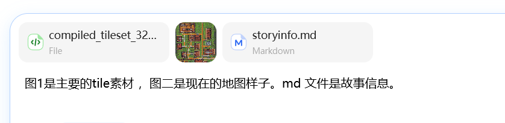

# 修改地图集.修改.地图.延城一中
## 让用文字描述给我说 它应该是长什么样子的
```
看了截图，先说清一件事，再给你描述"它应该长什么样"。

## 为什么你看不出变化

我们之前改的全是**数据层**：地图名、进图旁白、NPC 名字、事件对话、任务文案——瓦片美术一张没动（当时定的策略就是"只改数据层，美术完全复用"）。截图里其实已经有改动的痕迹：`数学老师 / 语文老师 / 小满 / 邻座同学 / 路过的同学 / 任务板 / 往网球场` 这些头顶名都是改出来的。但**静态画面确实还是奇幻村**——你的感觉没错。

## 延城一中应该长什么样（对照你的截图，逐区说）

**总印象**：现在这张图是"荒野里的村落"——13 栋散落小木屋 + 草地 + 土路。延城一中应该是"**围墙圈住的校园**"：一动不动的教学楼、太安静的走廊、下午第四节课空掉的运动场。核心氛围是"熟悉的地方，但哪里不太对"。

| 截图位置 | 现在的样子 | 应该是 |
|---|---|---|
| 左上红地毯大厅 | 领主大厅：长桌、王座感 | **高一（4）班教室**：成排课桌椅朝向讲台，讲台后一块深色黑板，苏晓站在讲台侧——第三排靠窗有个空位，那是林凡的座位，全班只有它积着灰 |
| 大厅北侧柜子排 | 酒吧柜台感 | **教师办公室**隔断：三张办公桌，三位老师各坐一处，作业本堆着 |
| 中上两间（书架+方桌） | 民宅 | **自习室 / 图书角**：书架当书柜刚刚好，桌上摊着没人收的练习册 |
| 右侧带床的小楼 | 卧室 | **医务室**：床可以直接用，加一张桌、药柜 |
| 中右灰石小院 | 石砌祠堂 | **升旗台 + 校园公告栏**：灰石质感反而最贴，任务板挂在这里变成"公告栏"正合适 |
| 右下桌椅长案大厅 | 集会堂 | **食堂 / 阶梯教室**：长案当餐桌或大课桌都成立 |
| 南部小屋 | 民宅 | **器材室**：魏叔（体育老师）守着，里面堆球网和标志桶——他那句"球场没人啊"就从这儿说出 |
| 东南草地出口 | 土路缺口 | **东侧小门**："往网球场"，放学后才该有人去的地方 |
| 橙色土路 | 乡间土路 | **校园水泥主干道**：换灰色石板/水泥瓦，笔直、没有岔路风情 |
| 木栅栏 | 村庄围栏 | **校园围墙**：换成砖墙或铁栏杆，只留校门和小门两个口 |
| 散落的树 | 野地树 | **行道树**保留，校园梧桐本来就长这样 |

**氛围细节**（进图旁白已在讲的事，画面要跟上）：theme 是"校园·课间"——应该是暖黄的下午光、影子拉长、广播含糊地念着名字、走廊上没有人声。现在画面传达的是"冒险村"，要改成"**放学后没人敢多留的校园**"。

## 落地分三档，你选

- **A 纯瓦片重排（零贴图改动，最快）**：室内重摆——课桌成排朝向、黑板用深色瓦片拼、灰石院做升旗台、土路换石板瓦、围墙缺口收成校门。图集里现有瓦片就够。
- **B 关键贴图替换（中成本）**：木墙→砖墙教学楼立面、土路→水泥路、专门画一块黑板瓦。走你 `贴图修改.md` 那套流程（程序化生成 32×32，不用 AI 生图）。
- **C 全面重绘（高成本）**：操场跑道、旗杆、新立面。不推荐先做。

ai的建议：**先 A 后 B**——A 就能让"村"变"校"，B 补立面的最后一步。

```

## step1:在ai 的这个分析后，让它直接干活
结果：一塌糊涂
我认为问题是ai 瞎几把乱改。
因此我先让它看见地图和知道各种瓷砖和素材（tile）是什么。
也就是技能：cognitive-tiles-maps
用法：
- /cognitive-tiles-maps workshops/toonflow-field-survival/map_design/黑塔：从超忆症开始成神/maps/mulberryTown.json 
现在长什么样，都有什么
- /cognitive-tiles-maps workshops/toonflow-field-survival/map_design/黑塔：从超忆症开始成神/maps/mulberryTown.json 
最新效果截图
- /cognitive-tiles-maps workshops/toonflow-field-survival/map_design/黑塔：从超忆症开始成神/images/compiled_tileset_32x32.original.png 都有什么瓷砖素材

## step2:cognitive-tiles-maps 使用后 +tiles-maps-editor
### 用法：
- /tiles-maps-editor workshops/toonflow-field-survival/map_design/黑塔：从超忆症开始成神/maps/mulberryTown.json 
**A 纯瓦片重排（零贴图改动，最快）**：室内重摆——课桌成排朝向、黑板用深色瓦片拼、灰石院做升旗台、土路换石板瓦、围墙缺口收成校门。图集里现有瓦片就够。
**B 关键贴图替换（中成本）**：木墙→砖墙教学楼立面、土路→水泥路、专门画一块黑板瓦。
实现A 和 B 。
- /tiles-maps-editor workshops/toonflow-field-survival/map_design/黑塔：从超忆症开始成神/maps/mulberryTown.json 
改成更贴合主题的风格
- /tiles-maps-editor workshops/toonflow-field-survival/map_design/黑塔：从超忆症开始成神/maps/mulberryTown.json 
修改街道布局

### 
依然一塌糊涂


## step3:先出图
尝试先出草图看看能否效果好一些


```
图1是主要的tile素材（compiled_tileset_32x32.png） ，图二是现在的地图样子。md 文件是故事信息（storyinfo.md）。
出个这个故事的其中一个地图：延城一中 的新效果图.要求要用图1的tile素材。与图2 画风一致！
```

/tiles-maps-editor 