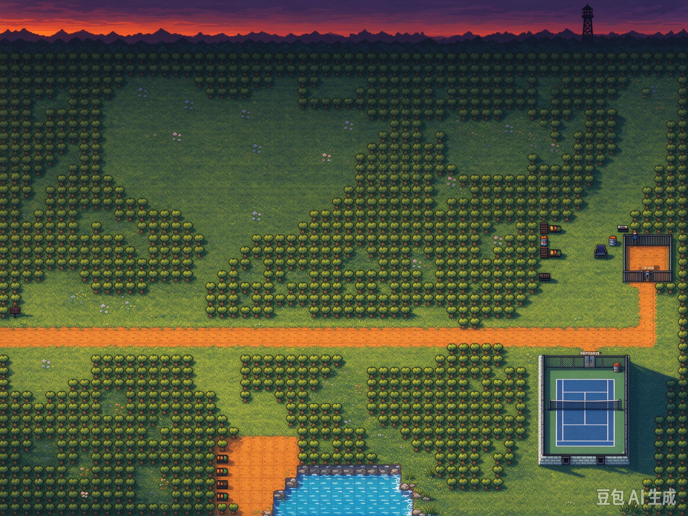

# 修改地图集.修改.地图.延城一中
在 修改地图集.修改.地图.延城一中.md 后的第二个图 （1到2）
## 让用文字描述给我说 它应该是长什么样子的
略

## step1:先出效果图
## 如豆包
```
/toon-maps-renderings出个符合主题的新效果图,当前是网球场，图1是现在的效果.
```


## step2:
分析从效果图要做什么
```
I'll look at the map JSON and the screenshot before touching anything.
Let me inspect the map JSON structure to see what tiles/props are actually there.
Let me dig into the tile layers, tilesets and the Actors layer to understand what "网球场" consists of.
Now let me decode the tile layers to see what the terrain actually looks like, and compare against the target screenshot.
Now let me render the actual tile map as ASCII to see the current layout vs. the target image.
Now let me build an ASCII renderer to visualize the three tile layers, and identify what the "网球场" (tennis court) region consists of.
Layer1 is just ground. Let me render the tree/prop layer (layer 2) which is the main visual, and identify the court region.
Now I can see the structure clearly. Let me verify what specific tiles the court area uses by extracting the actual tile sprites and checking the Tiled images.
Now I understand the tile vocabulary. Let me identify what the court tiles look like — the effect image shows a blue tennis court with a net. Let me search the tileset for court-related tiles.
No dedicated court tiles exist in the tileset. The "网球场" in the effect image is an AI-generated reference — the actual map renders a "stone floor + fence" area. Let me verify by extracting the actual tileset images and rendering the map region.
Now let me actually render this map to a PNG so I can see what it actually looks like vs. the target image.
Let me render the map to PNG so I can see the actual current state versus the target image.
PIL is available. Let me render the map to a PNG.
Now I can see the actual map vs. the target image. The gap is clear. Let me zoom into the court area (bottom-right, the stone-floored structure) to see exactly what's there.
Now I have complete clarity. Let me check what sports/court tiles exist in the broader Dawnlike tileset so I can propose the right fix.
Now let me check the full Dawnlike tileset for sports/court-related tiles more broadly (blue surface, net, line markings).
Now I have the complete picture. Let me verify the region the effect image shows vs. what the JSON's `eventZones`/notes describe, and check the story.json for map naming consistency.
Let me confirm the river/pond in the target image and check how the current map's water + pool area compares, plus verify the effect image's key features.
I have everything I need. Let me record the analysis to memory, then give you the plan.
网球场我先没动。下面是我查完代码和图集后的结论 + 改法。

## 先说三个关键发现

**1. 现在这张图里根本没有「网球场」**

我渲染了实际地图对比你的效果图。右下角那栋石砌建筑（tile x≈45-56, y≈26-39）是**器材房/仓库**：stone wall 围一圈，里面是灰色 stone floor，摆着 table、chair、crate、sleeping bag、cobwebs、torch。**没有球场地面、没有球网、没有看台**。

**2. 图集里根本没有球场瓦片 —— 这是硬约束**

`compiled_dawnlike.json`（Dawnlike_Compiled，13080 tile）全部 44 种 description 里，体育相关的只有 `fence`（栅栏），**没有 court / tennis / net / track / bleacher / turf**。

所以效果图里那种「蓝底白线 + 中间球网」的球场，**用现有图集还原不了**。这是改法的分岔点。

**3. 事件区坐标是错的**

`eventZones` 写着「球场中央(50,20) / 器材房(45,9) / 看台(40,8)」，但 (50,20) 是空地、(45,9) 是树 —— 全都对不上实际建筑位置。

## 改法（三档，你选）

### A. 最小改：把现成石头建筑改造成「校际赛球场」（不用改图集）

复用现有 `stone floor` + `fence`，在器材房内部分区：

| 步骤 | 改法 |
|---|---|
| 地面 | 内部 stone floor 保留，去掉 table/crate/sleeping bag（腾空） |
| 球场线 | 用 `stone wall`/`wooden wall` 细条拼出半场线 + 中线（描边式，非白线） |
| 球网 | 竖向 fence 一列（gid 3097/3098/3099/3217）横贯中央，带 `blocked:true` 已有 |
| 看台 | 北侧用 `wooden wall` 叠 2~3 层做阶梯（用 yc_school_style_tiles 的 roof_slate 更好） |
| 器材房 | 移到东南角，用 `yc_school_style_tiles.json` 的 wall_brick + classroom_floor 拼独立小屋 |

代价：视觉是「水泥球场」，和效果图那种专业塑胶场差一截。但**当天能出，且零图集改动**。

### B. 中档：给图集补球场瓦片（推荐，效果最接近）

改 `images/compiled_tileset_32x32.png` —— 加一条球场 tile 带（蓝色塑胶地面 3-4 变体 + 白线变体），再在 `compiled_dawnlike.json` 的 `tiles` 数组补对应 id 的 properties（`description:"tennis court"` 等）。

然后 A 档的拼装方案照抄，但换成新瓦片 → 能出效果图那种蓝白球场。

代价：要画 PNG（可以用 PIL 程序化生成蓝底白线，不一定要手绘），改图集后**所有引用这张图集的地图都要重新编译**。

### C. 大改：整图重做，贴近效果图

效果图是一张完全不同的构图：黄昏色调 + 远山天际线 + 更规整的森林布局 + 右侧木屋 + 泳池 + 球场。当前地图是「绿色密林 + 橙色土路」的风格，色调和布局都对不上。

要不要走到 C 取决于你的目标：

- **想要这张图作为关卡实景** → 走 C，我按效果图重排整个 tile layout（含远景山带、泳池、看台）
- **只想让球场那块像样** → 走 B

## 另外要确认的两件事

1. **色调**：效果图是黄昏（橙红天空 + 长影），当前图是白天绿。`theme` 已经写了 `"户外·黄昏"`，但没有实现黄昏光照 —— 这需要引擎侧支持还是靠图集配色？
2. **eventZones 坐标**：无论选哪档，都得把 4 个事件区的坐标对齐到实际位置（现在是错的），否则「球场中央」「网带阴影」的叙事触发点会落空。

---

选 A / B / C，或者告诉我你倾向哪一档，我再动手。
```

## step 3:选方案
例如：B

##