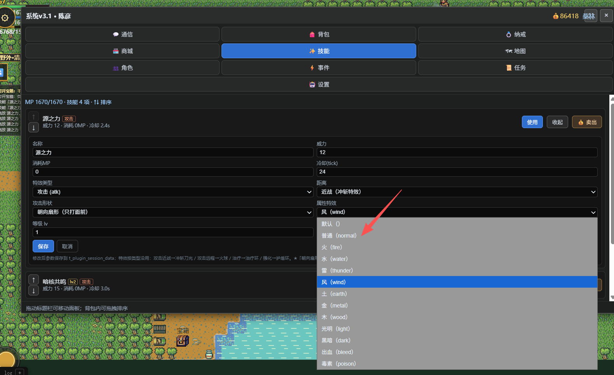
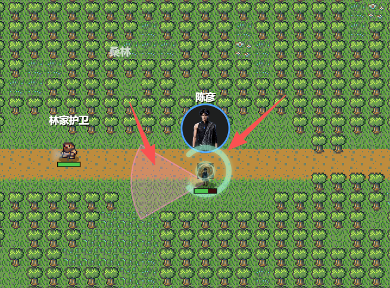
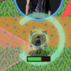

# 属性特效

## 首先V1 这个 图标（图样）
[游戏特效.md](../V1/%E6%B8%B8%E6%88%8F%E7%89%B9%E6%95%88.md)

\images\spells
| effects_type | 图标 |
|---|---|
| normal | `enchantment/sure_blade.png` |
| fire | `fire/fireball.png` |
| water | `ice/freeze.png` |
| thunder | `air/lightning_bolt.png` |
| wind | `air/tornado.png` |
| earth / metal | `earth/iron_shot.png` |
| wood | `poison/poison_arrow.png` |
| light | `restoration/minor_heal.png` |
| dark | `necromancy/agony.png` |
| poison | `poison/alistairs_intoxication.png` |
| bleed | `necromancy/bolt_of_draining.png` |

## 改造1
没有V1 要求的使用时显示出来 属性特效。下拉框把图标也 显示出来

## 改造2

在攻击范围，扇形就只显示在扇形范围内出现1个或多个半透明的这些图片模仿粒子特效

## 改造3
野怪头上的血条改成半透明。

## 改造4
特效的圆形

颜色效果半径减半，更加透明度化

## 改造5
野怪普攻也要有普攻特效（密度控制最多5个野怪特效效果）
特效叠加优化，单个野怪的技能特效 4个开始就得立即清除前面的残留，只留最新三个。

## 改造6
用户技能特效叠加优化，4个开始就得立即清除前面得残留，只留最新三个。

