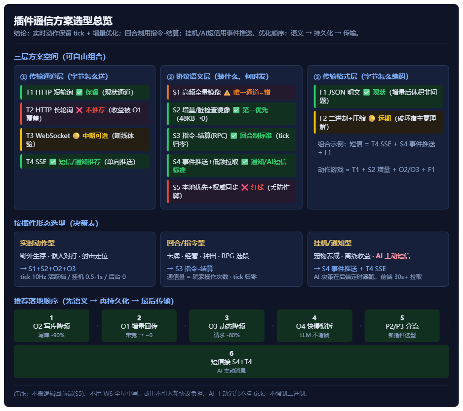

# 插件的各种可行通信方案和对比

> v1.0 · 2026-11-01
> 基于《插件的网络通信机制_v1.md》的现状分析（tick 链路、成本清单 C1-C7、优化项 O1-O6、分流协议 P1/P2/P3），
> 本文把"可行通信方案"从**传输通道 / 协议语义 / 传输格式**三个层面系统展开，给出对比矩阵与选型结论。
> 代码依据：`Toonflow-game-web/src/components/ScenePlay.vue`（5175 宿主）、`toonflow-game-app/src/routes/plugin/tick.ts`（60002 后端）、`plugins/toonflow-field-survival/vue/src/App.vue`（插件前端）。

---

## 0. 一句话结论（决策摘要）

- **实时动作游戏**（野外生存/假人对打）：保留 10Hz tick，但必须叠加 **增量回传(O1) + 写库降频(O2) + 动态降频(O3)**，成本可降 90% 以上；
- **回合/指令型**（卡牌、种田、经营、RPG 选段）：改用 **指令-结算协议**，tick 频率归零，通信量 = 玩家操作次数；
- **挂机/通知/异步**（宠物养成、离线收益、**AI 主动短信**）：改用 **事件推送协议**，低频拉取或宿主 ws 推送；
- **不要**用 WebSocket 全量重写链路（边际收益主要只在断线体验），**更不要**把游戏逻辑搬回前端（丢掉权威状态/防作弊/多端一致）。


[优化与替代v1.html](%E4%BC%98%E5%8C%96%E4%B8%8E%E6%9B%BF%E4%BB%A3v1.html)
---

## 1. 现状回顾（为什么需要这篇文章）

### 1.1 一次 tick 的旅程

```
插件前端 (iframe, 60002 game.html)
  │  每 100ms localTick() + postMessage({type:'tf_plugin_tick'})
宿主 (5175 ScenePlay.vue) → POST /plugin/tick（10Hz）
后端 (60002 tick.ts) → 串行锁 → 读 session.stateJson + plugin_state(~48KB)
  → entry.js step() 代跑游戏逻辑 → 写库 ×2 → 返回完整 resultState(~48KB)
宿主 → postMessage({type:'tf_plugin_state'}) → 插件渲染
```

### 1.2 关键参数

| 参数 | 值 |
|---|---|
| TICK_MS / SEND_MS | 100ms / 桌面 100ms、移动端 200ms |
| 单次 tick 响应 | ~48KB（完整 plugin_state，**下行**；上行仅 input+位姿，很小） |
| 稳态流量 | ≈ 10 req/s × 48KB ≈ 每秒 ~500KB 的**响应**序列化/解析 |
| 每 tick 写库 | 历史上 2 次；**现状 1 次**（stateJson 本就只在非 tick/over 时 UPDATE；plugin_state 已加节流，见 §7 实施状态） |
| 会话并发 | 串行锁（sys_brain 慢命令也抢同一把锁） |

> ★ 实施状态速记（2026-11-01）：**O2 已落地**——`tick.ts` 增加 `PLUGIN_STATE_FLUSH_MS=2000`
> 节流 + 无变化跳过 + forceSync 例外（phase 变化 / over 结算 / 非 tick 命令），
> 挂机时 plugin_state 写库从 10 次/秒 → ≤0.5 次/秒，无变化时为 0。

### 1.3 成本清单（速览）

| # | 成本 | 量级 | 本质 |
|---|---|---|---|
| C1 | 无效轮询 | 挂机也 10Hz 照发 | 协议语义问题 |
| C2 | 全量回传 | 48KB/次，90% 字段不变 | 协议语义问题 |
| C3 | 双写库 | 20 写/秒/会话 | 持久化策略问题 |
| C4 | 序列化 CPU | 2×48KB×10Hz | 传输格式问题 |
| C5 | 慢命令堵帧 | sys_brain(1-5s) 占串行锁 | 通道隔离问题 |
| C6 | HTTP 开销 | 10 req/s 固定成本 | 传输通道问题 |
| C7 | 断线体验 | 靠 failStreak 探测 | 传输通道问题 |

> 关键洞察：C1/C2 是**协议语义**问题（装什么、何时发），C3 是**持久化**问题，C4/C6/C7 是**传输层**问题。
> 优化必须分层面打，单换通道（如 WebSocket）解决不了 C1/C2/C3。

---

## 2. 通信方案全景（三个层面）

### 2.1 传输通道层（字节怎么送到对端）

| 方案 | 方向 | 一句话 |
|---|---|---|
| **T1 HTTP 短轮询** | 客户端→服务端 | 客户端定时问"有没有变化"（现状） |
| **T2 HTTP 长轮询** | 客户端→服务端 | 请求挂起，服务端有变化才返回 |
| **T3 WebSocket** | 全双工 | 一条长连接双向推流，断线可重连 |
| **T4 SSE** | 服务端→客户端 | 单向服务器推送，客户端用普通请求上行 |

### 2.2 协议语义层（消息里装什么、何时发）

| 方案 | 一句话 |
|---|---|
| **S1 高频全量镜像** | 每帧把完整状态发过去（现状，唯一通道） |
| **S2 增量/脏检查镜像** | 只发变化字段，无变化回 null（O1） |
| **S3 指令-结算（RPC）** | 玩家操作才发，后端结算一次返回结果（P2） |
| **S4 事件推送 + 低频拉取** | 后端事件驱动落库，前端 30s~5min 拉增量（P3） |
| **S5 本地优先 + 权威同步** | 前端跑逻辑，周期性提交增量快照（乐观并发） |

### 2.3 传输格式层（字节怎么编码）

| 方案 | 一句话 |
|---|---|
| **F1 JSON 明文** | 现状，48KB/次 |
| **F2 二进制 + 压缩** | msgpack/Protobuf + gzip，48KB→6-10KB（O6） |

> 三层可自由组合。例如"SSE 通道 + 事件推送语义 + JSON"就是短信功能的最优解之一。
> 优化顺序永远是 **先语义层（S2/S3/S4）→ 再持久化（O2）→ 最后才动传输层（T3/T4/F2）**，因为语义层拿走 90% 成本。

---

## 3. 逐方案详述

### 3.1 传输通道层

#### T1 HTTP 短轮询（现状）

- **链路**：iframe → postMessage → 宿主 → POST /plugin/tick → 后端 → 回包
- **优点**：实现最简单；宿主哑管道天然支持；无需改后端路由；同源 keep-alive 下头部开销可控
- **缺点**：挂机空转（C1）；断线靠探测（C7）；请求频率受限（10Hz 已是上限）
- **本项目定位**：保留。配合 S2/S3 语义优化后，挂机流量归零

#### T2 HTTP 长轮询（Comet）

- **链路**：客户端发一个请求挂起 → 服务端有变化/超时才返回 → 客户端立刻再发一个
- **优点**：比短轮询省"无变化"的无效往返；断线感知比探测快
- **缺点**：服务端要挂住连接（连接数 = 在线客户端数）；代理/浏览器有超时限制；请求排队与现有串行锁叠加更堵；实现复杂度 > 收益
- **本项目定位**：**不推荐**。收益被 T1+O1（空 patch 秒回）覆盖，还引入挂起连接管理。如果宿主已有 keep-alive，短轮询的"空响应"成本极低。

#### T3 WebSocket

- **链路**：iframe ↔ wsHub（宿主）↔ 内部调用 /plugin/tick（后端零改动）
- **优点**：全双工低延迟；断线重连语义替代 failStreak 探测；AI 慢命令可走独立 ws 消息类型
- **缺点**：要新增宿主 wsHub 组件；连接生命周期/心跳/重连逻辑要自己写；同源部署下 HTTP/1.1 keep-alive 头部开销本就不大，纯性能收益有限
- **本项目定位**：**中期可选**。O1-O4 落地后收益主要在断线体验；真正值得做的前提是"出现需要服务端→客户端即时推送的场景"（见 T4）。

#### T4 SSE（Server-Sent Events）

- **链路**：宿主对每个游戏会话开一条 SSE；后端有事件（AI 短信、战斗结算、成就）→ 推送；客户端上行仍走 postMessage/HTTP
- **优点**：单向推送实现成本远低于 ws（原生 EventSource、自动重连）；完美匹配"AI 主动发短信/通知"这类低频下行场景；与现有"客户端主动请求"模型互补
- **缺点**：单向——客户端上行还得走 HTTP；连接数 = 会话数
- **⚠️ 跨域中继（成败关键）**：插件 iframe 与宿主**不同源**（60002 game.html 嵌在 5175 里）且拿不到 JWT——**iframe 无法自己开 SSE**。正确链路是：
  `后端 ──SSE──► 宿主(5175, 持 JWT) ──postMessage 中继──► 插件 iframe`。
  宿主加一个 `tf_plugin_event` 消息类型即可，插件前端零网络代码——这也正好维持"宿主哑管道"（只透传事件，不理解内容）。
- **本项目定位**：**短信/通知功能推荐通道**。P3 事件推送语义 + SSE 下行，是"AI 主动给玩家发短信"最自然的形态。

### 3.2 协议语义层

#### S1 高频全量镜像（现状）

- 每 100ms 发完整 state。适合实时动作游戏（权威模拟需要），但作为唯一通道是错的。

#### S2 增量/脏检查镜像（= 原版 O1）

- 后端 step() 后 diff 上一帧，只回变化字段；无变化回 `{ code:0, state:null }`，宿主跳过 postMessage。
- **收益**：挂机 48KB→0；战斗只回动了的那几个实体；首帧/切图强制全量。
- **注意**：前端合并语义必须"整包替换 or 逐字段覆盖"二选一，全链路一致，避免半新半旧 state。
- **本项目定位**：**第一优先级**。与现有 localEnemies epoch 机制同构。

#### S3 指令-结算协议（= 原版 P2）

- 玩家出招才发：`postMessage({action:'play_card', ...})` → 后端结算一次 → 返回结果。无 tick。
- **收益**：通信量 = 玩家操作次数；后端零空闲计算；写库 = 操作频率。
- **成本**：插件 manifest 声明 `interaction:"turn-based"`；宿主/后端路由几乎零改动（tick.ts 已支持任意 action）；插件侧给回合制模板（天然不发 tick）。
- **本项目定位**：**回合/策略/卡牌/经营类插件的标准形态**。

#### S4 事件推送 + 低频拉取（= 原版 P3）

- 后端定时器/事件驱动产生状态 → 落 plugin_data → 前端 30s~5min 拉一次增量（或经 T4 SSE 即时下行）。
- **收益**：通信量趋近于零；数据一致性由后端保证。
- **⚠️ 隐藏前提（别想当然）**：当前 **AI 决策上下文（性格 / 记忆 / 感知 / 场景状态）全在前端 `aiStates` 里**（`vue/src/ai/brain.ts` 的模块级 Map），后端定时器**拿不到**。所以后端定时器不能自己跑 LLM 决策，它只能：
  - **方案 A（推荐，成本低）**：后端定时器只发「**唤醒事件**」（如"该角色到了主动发消息的时间"）→ 经 SSE/低频拉取通知前端 → **前端**用本地 AI 状态跑决策 → 走既有 sys_brain 通道出结果。AI 状态不迁移，链路最短。
  - **方案 B（重）**：把 AI 状态（personality/memory/perception）迁到后端持久化 → 后端定时器可独立决策。代价大：记忆/感知的权威归属要重新设计，且会与"前端本地预推进"冲突。
- **本项目定位**：**AI 主动短信 / 离线收益 / 成就推送的标准形态**。当前"玩家发短信 → 前端 P0 唤醒 LLM"是对的；但"AI 主动发"若靠前端 tick 心跳驱动，就是 S1 语义做 P3 的事（反面教材）。落地上按上面的**方案 A**。

#### S5 本地优先 + 权威同步（乐观并发）

- 前端直接跑全部游戏逻辑，只在关键节点（结算/退出/每 N 秒）提交增量快照；后端权威校验。
- **优点**：离线可用、延迟归零、写库极少。
- **缺点**：防作弊大幅弱化（玩家可改内存）；多端同时玩会产生冲突（要 CRDT/版本向量）；和现有"权威状态在后端"的三大收益（防作弊/多端一致/换端不丢）直接冲突。
- **本项目定位**：**明确不做**（原版第七节红线）。仅在单机离线模式或纯展示型插件可考虑。

### 3.3 传输格式层

#### F1 JSON 明文（现状）

- 可读、调试友好；48KB/次。O1 增量后体积已经不是问题。

#### F2 二进制 + 压缩（= 原版 O6）

- msgpack/Protobuf + gzip，48KB→6-10KB。
- **本项目定位**：**远期，通常不必要**。O1 做完后增量 patch 本来就小，此项收益锐减；仅当出现大规模同屏实体插件再考虑。注意宿主是哑管道，二进制格式要求宿主侧也要认知格式，反而破坏"零理解"的插件生态优势——这也是二进制方案在本项目的隐藏成本。

---

## 4. 多维对比矩阵

### 4.1 传输通道层对比

| 维度 | T1 短轮询 | T2 长轮询 | T3 WebSocket | T4 SSE |
|---|---|---|---|---|
| 端到端延迟 | 10Hz 粒度 | 即时（有变化即返） | 即时 | 即时 |
| 稳态流量 | 高（空转） | 中（省空转） | 低 | 低 |
| 服务端连接模型 | 无连接 | 挂起连接 | 长连接+心跳 | 长连接+自动重连 |
| 断线恢复 | failStreak 探测 | 超时重发 | 协议级重连 | 原生重连 |
| 宿主改造量 | 0 | 中 | 高（wsHub） | 中 |
| 后端改造量 | 0 | 低 | 低（复用路由） | 低 |
| 移动端适配 | 已有（200ms） | 一般 | 好 | 好 |
| 结论 | ✅ 保留 | ❌ 不推荐 | 🟡 中期可选 | ✅ 短信/通知推荐 |

### 4.2 协议语义层对比

| 维度 | S1 全量镜像 | S2 增量镜像 | S3 指令-结算 | S4 事件推送 | S5 本地优先 |
|---|---|---|---|---|---|
| 通信量 | 10Hz×48KB | 变化才发 | 操作次数 | ≈0 | ≈0 |
| 后端计算 | 10Hz 空转 | 10Hz 但空转廉价 | 仅操作时 | 仅事件时 | 仅同步时 |
| 写库频率 | 2 次/tick | 脏标记+低频 | 操作级 | 事件级 | 同步级 |
| 权威性/防作弊 | ✅ | ✅ | ✅ | ✅ | ❌ |
| 多端一致 | ✅ | ✅ | ✅ | ✅ | ⚠️ 需冲突处理 |
| 离线支持 | ❌ | ❌ | ❌ | 半（低频拉取可缓存） | ✅ |
| 实现成本 | 0（现状） | 低（diff+判空） | 极低（manifest+模板） | 低（定时器+落库） | 高 |
| 适用形态 | 实时动作 | 实时动作（优化） | 回合/策略/经营 | 挂机/通知/AI短信 | 纯离线/展示 |
| 结论 | 唯一通道=错 | ✅ 第一优先 | ✅ 回合制标准 | ✅ 通知标准 | ❌ 红线 |

### 4.3 组合推荐速查

| 你的插件是... | 通道 | 语义 | 格式 |
|---|---|---|---|
| 实时动作/射击/走位 | T1 短轮询 | S1+S2（加 O2/O3） | F1 |
| 回合制/策略/卡牌 | T1（仅在操作时） | S3 指令-结算 | F1 |
| 挂机/养成/AI 短信 | T4 SSE 下行 + T1 低频 | S4 事件推送 | F1 |
| 大规模同屏实体（远期） | T3 可选 | S2 | F2 |

---

## 5. 按插件形态选型（决策表）

| 形态 | 协议 | tick 频率 | 关键改动 |
|---|---|---|---|
| 实时动作（野外生存/假人） | S1+S2+O2+O3 | 10Hz 活跃档 / 挂机 0.5-1s / 后台 0 | 后端 diff + 前端判空 + 脏落盘 |
| 回合/指令（卡牌/经营/RPG 选段） | S3 指令-结算 | 0 | manifest 声明 + 回合制插件模板 |
| 挂机/通知（宠物/离线/AI 短信） | S4 事件推送 | 0（拉取 30s+） | 后端事件定时器 + 前端低频拉取/SSE |

---

## 6. 与现有业务场景的结合

### 6.1 AI 主动发短信（通信(短信) 功能）

- **现状正确部分**：玩家发短信 → 前端 P0 唤醒 LLM（sys_chat/sys_brain 通道）；
- **应改部分**：AI 主动发短信**不能**靠前端 tick 心跳驱动（那是 S1 语义做 P3 的事，反面教材）；
- **目标形态（按 S4 方案 A）**：后端定时器判定"该角色到了主动说话的时间" → 落事件（`t_plugin_session_data` 或新建事件表）→ 经 T4 SSE 通知宿主 → 宿主 postMessage 中继 → 插件前端收到唤醒 → **前端**用本地 AI 状态跑决策 → 短信落 `sms_conversations` → 同一 SSE 通道把新短信推给前端 → 刷新未读角标。
- **AI 状态不迁移**（性格/记忆/感知仍在前端 `aiStates`）——后端只做"到点提醒"，LLM 决策仍在插件内跑。这是成本最低、且不破坏现有权威模型的形态。
- **未读角标**：随 SSE 事件同步刷新。

### 6.2 AI 托管决策（sys_brain）

- sys_brain（LLM 1-5s）与帧 tick 抢同一把串行锁 → **拆快慢锁**（O4）：
  - fastLock：帧 tick / 移动 / 技能；
  - slowLock：sys_brain / sys_chat / 商城生成；
  - 两者写 plugin_state 的互斥保留（快锁 UPSERT 与慢锁最终 flush 互斥），只是不让慢命令占着帧锁。

### 6.3 多会话并发

- 现状 SQLite 单写者锁下多会话互排队 → O2 写库降频后竞争显著缓解；
- 若未来多会话成为常态，先量化验证（3-5 会话 P95 抖动）再决定是否升级存储。

---

## 7. 推荐落地顺序

| 阶段 | 内容 | 预期收益 | 改动面 |
|---|---|---|---|
| ~~第一步~~ | ~~O2 写库降频~~ | ✅ **已实施（2026-11-01，tick.ts）**：节流 2s + 无变化跳过 + forceSync 例外；挂机写库 10/s → ≤0.5/s | 已合并 |
| **第二步** | O1 增量回传（304 语义） | 挂机带宽/序列化 → ~0 | tick.ts diff + 前端判空 |
| **第三步** | O3 动态降频（活跃/挂机/后台三档） | 挂机请求 -80% | 插件 App.vue ~10 行 |
| **第四步** | O4 快慢锁拆分 | sys_brain 不再堵帧 | tick.ts 锁拆分 |
| **第五步** | P2/P3 分流（S3/S4）+ 插件模板 | 新插件按需选型 | manifest + 模板 |
| **第六步** | 短信功能接入 S4 + T4（SSE，宿主中继） | AI 主动消息零成本落地 | 后端事件 + 宿主中继 + 前端拉取 |
| 远期 | T3 WebSocket / F2 二进制 | 断线体验 / 大规模实体 | 宿主 wsHub |

### 动手前先量化（验证基准）

1. 单会话稳态：`POST /plugin/tick` 的 P50/P95 延迟与响应字节数（宿主日志已带 `- 48577` 字样）；
2. 多会话（3-5 个）下 SQLite 写锁竞争（观察 tick P95 抖动）；
3. sys_brain 期间帧 tick 的 P99 延迟（验证 C5）。

---

## 8. 不要做的（红线）

- **不要把游戏逻辑搬回前端**（S5）——丢掉权威状态/防作弊/多端一致三大收益，是开倒车；
- **不要用 WebSocket 全量重写链路**"顺便"解决轮询——O1/O2 已拿走 90% 成本，ws 边际收益主要在断线体验；
- **不要让 diff 变成新协议负担**——patch 只用于传输，合并语义全链路一致，避免半新半旧 state；
- **不要让 AI 主动消息挂在 tick 心跳上**——那是用实时语义做异步场景，成本全付、体验还差；
- **不要在插件生态里强推二进制格式**——宿主哑管道的"零理解"优势会被格式认知破坏。

---

## 附：方案命名对照（与原版 O/P 编号）

| 本文 | 原版《插件的网络通信机制_v1.md》 |
|---|---|
| T1 短轮询 | 现状 tick 通道 |
| T3 WebSocket | O5 |
| T4 SSE | （新增） |
| S2 增量镜像 | O1 |
| O2 写库降频 | O2 |
| O3 动态降频 | O3 |
| O4 快慢锁 | O4 |
| S3 指令-结算 | P2 |
| S4 事件推送 | P3 |
| S5 本地优先 | 第七节"不要做" |
| F2 二进制 | O6 |
| P1 实时动作保留 | P1 |
