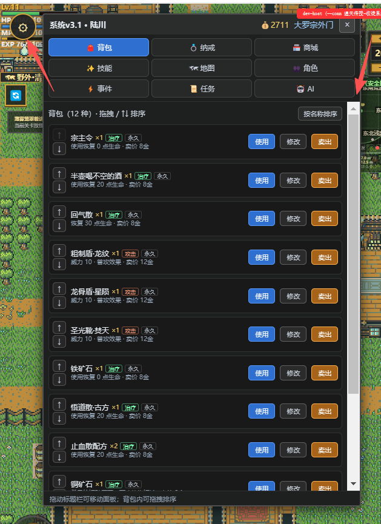

# 通信(短信)

在系统这个按钮上显示 有多少未读消息
标签页增加：通信(短信) 这个标签页

## 需求分析
1.未读消息 显示:系统这个按钮上显示,通信(短信) 标签页上显示。  清零机制是什么？
2.ai 托管的角色会主动发送短信给用户，也可以发送到群聊
3.通信(短信) 要实现微信类似的群聊和单聊功能
4.群聊和单聊的通讯录 和消息 存储在哪里？插件数据还是存到ai 聊天台词列表或者都存？

### 需求澄清（v2 补充）
5.**玩家 → AI 也必须能聊**（不只是 AI 单向发消息）。玩家发短信后目标 AI 需立即回复。
6.**落点形态**：通信是**系统面板内的一个 tab**（不是独立浮窗），排在 tab 列表**第一位**。
7.**存储隔离**：短信按**故事**隔离（`sms_conversations:<story>`），换故事不串号。
8.**容量封顶**：单会话 ≤100 条消息、≤50 个会话，防止 JSON 无限膨胀。
9.**与既有「角色对话」并存**：面对面对话走发言器 agent（内存态），短信走 AI 托管大脑（持久化），两者不合并。

### 需求澄清（v3 补充 · 会话入口）
10.**会话列表只放已有会话**，不在列表里直接列全部角色（几十个角色会把真正的会话淹没）。
    找人走**顶部搜索框 → 下拉**：下拉分三段 ——「已有群聊 / 还没建过单聊的角色（带「托管」标识）/ ＋新建群聊」。
11.**玩家可以主动发起单聊**：在通讯录下拉里点某人 → 会话立刻建出来并打开，右半屏马上能打字。
    （与「AI 第一次发消息才建会话」是两条独立路径，互不替代。）
12.**已建过单聊的角色不再重复出现在下拉里**（避免同一个人出现两次）。

### 需求问题回答速查

| # | 问题 | 结论 |
|---|---|---|
| 1 | 未读显示在哪 / 清零机制 | 系统按钮角标 + 通信 tab 角标 + 会话项角标（三处数值一致）；进会话即清零，玩家发消息即清零，system 消息不计入未读 |
| 2 | AI 主动发短信 | 心跳决策的同一次 JSON 里带 `message` 字段；群聊 `to:"group:<id>"`；拿不到 LLM 则不发 |
| 3 | 微信式群聊 + 单聊 | 数据结构 + UI 已设计；群聊第二期实现，含 AI 群消息频率上限 |
| 4 | 存哪里 | **存 `t_plugin_session_data`**（`sessionId="all"` + `dataKey="sms_conversations:<story>"`），**不存 AI 台词列表** |
| 5 | 怎么找人 / 怎么发起会话 | 顶部搜索框 → 下拉（群聊 / 角色 / ＋新建群聊）；点角色 → **主动建单聊并打开** |

---

## 详细设计
[通信(短信).design.md](%E9%80%9A%E4%BF%A1%28%E7%9F%AD%E4%BF%A1%29.design.md) —— v2

## 原型图设计
[原型图](%E5%8E%9F%E5%9E%8B%E5%9B%BE) —— v2（系统面板内嵌 tab 形态）

## 评审记录
[评审意见.md](%E8%AF%84%E5%AE%A1%E6%84%8F%E8%A7%81.md) —— v1 评审发现的 3 个硬伤 + 6 项遗漏，v2 已全部修正